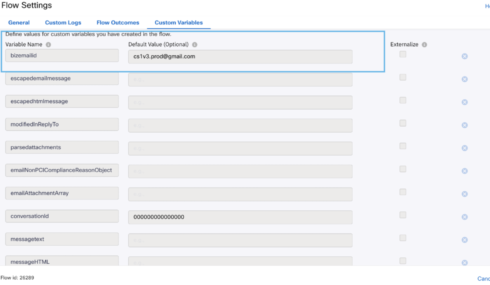

# Media Specific Workflows

> ## Version Highlights
>
> - Attachment validation now processes all email attachment types, including  `.msg`, and `.eml`.
> - Inline attachment metadata such as `cid` is preserved for proper message rendering and embedded content mapping.
> - PCI and security checks still run for each attachment, with rejected items marked as dropped and accepted items kept in the payload.
>
>
> Each attachment is validated against the PCI non-compliance attachment list and then categorized as:
>
> - **Dropped** (`"dropped": true`) when it matches a rejected attachment
> - **Accepted** (`"dropped": false`) when it passes validation
>
> No MIME-type-based exclusion is applied.

## Workflows Overview

The following workflow templates are included:

**Media Specific Workflows**: These flows must be imported once per asset for the specific channel.

- **Email Inbound Flow**: Triggered for every inbound customer email received by the integrated email account.

### Important Notes

- Queue selection in the Queue Task node is mandatory for any channel flow before making the flow live.
- Flow variables must be updated in the Settings section with the correct asset details before making the flow live.

## Updating Flow Variables

The following flow variables must be updated under the custom variables section for each channel:

- Email: `bizemailid`

### Email Inbound Flow Details

The Email Inbound Flow is triggered when an email is received by the configured email application. It parses the email content and attachment information, creates the Webex Contact Center conversation, sends a resolution notification, queues the task, and sends a task-queued notification.

#### Email Flow Sequence

`Configure Email Event` → `Parse Variables` → `Resolve Conversation` → `Email (Message is resolved.)` → `Queue Task` → `Email (Task queued.)`

Error and timeout paths send an email containing the relevant error message and can continue to the close-task handling path.

#### 1. Configure Email Event

The Start node is configured with:

- Channel: `Email`
- Event: `Incoming Message`
- Conditions: Not enabled

The email application can be selected before the flow is made live. The node starts the flow for every inbound message received by the configured email application.

#### 2. Parse Variables

This Evaluate node prepares the email data for the Resolve Conversation node. It uses one script output:

- Script output: `1`
- Branch name: `success`

#### The Scipt:

- Extracts the flow portion from `transid`.
- Normalizes `modifiedInReplyTo` by wrapping a populated value in quotes or setting it to an empty quoted value.
- Provides `<del>No Content</del>` when the message body, HTML body, stripped text, or stripped HTML is empty.
- Parses the PCI-compliance attachment payload and identifies attachments that were dropped.
- Compares attachment names with the non-PCI attachment list.
- Builds attachment details with MIME type, filename, URL, CID, and `dropped` status.
- Preserves the attachment `cid` value so inline email content and embedded images can be mapped correctly when the message contains content IDs.
- Uses `https://nourl.net` for dropped attachments or attachments without a URL.
- Uses `no_filename` or `default_name` when an attachment filename is missing.
- Applies `defaultSenderName` and `defaultSubject` when the sender name or subject is blank.
- Builds `messageDetails`, `pciDetails`, `malwareScanDetails`, and `securityScanDetails`.
- Serializes the final object as `detailsJson`.

The script expects email variables such as `messagetext`, `messageHTML`, `messageStrippedText`, `messageStrippedHTML`, `attachments`, `emailAttachmentArray`, `emailNonPCIComplianceReasonObject`, sender and recipient details, message headers, PCI variables, malware variables, and security-scan variables. The `cid` field is especially important for inline attachments where the email body references embedded content using a content ID.

#### 3. Resolve Conversation

This node creates or resolves the Webex Contact Center email conversation.

- Method: `Resolve Conversation`
- Node authentication: `Your configured authorization profile`
- Flow ID: `Use the applicable flow ID for your tenant`
- Trans ID: `$(transId)`
- Media type: `Email`
- Media channel: `Email`
- Details: `$(detailsJson)`
- Override Default Contact Close Event Handling: Not enabled
- Version: `v1.3`

The `detailsJson` value generated by the Parse Variables node contains the email message, recipients, subject, headers, attachments, and compliance-scan details.

#### 4. Resolution Email

After the conversation is resolved, an Email node sends a confirmation to the customer.

- Destination type: `Email Id`
- Destination ID: `$(email.emailId)`
- From Email: Not configured
- From Name: `$(bizemailid)`
- Reply-To: Not configured
- CC/BCC: Not configured
- Email type: `Text`
- Subject: `$(subject)`
- Message: `Message is resolved.`
- Notify Status: Not enabled
- Attachments: No attachment configured
- SMTP header: `In-Reply-To`
- Header value: `$(email.messageId)`

The `In-Reply-To` header helps keep the notification associated with the existing email thread.

#### 5. Queue Task

The Queue Task node submits the email conversation to Webex Contact Center.

- Method: `Queue task`
- Node authentication: `Your configured authorization profile`
- Task ID: `$(taskId)`
- Conversation ID: `$(conversationId)`
- Media type: `Email`
- Media channel: `Email`
- Queue mode: `Static`
- Queue name: `Your configured queue name`
- Contact priority: `As configured for your environment`
- Queue routing type: `Longest available agent`
- Version: `v1.8`

The queue must be selected and reviewed for the target tenant before the flow is made live.

#### 6. Task-Queued Email

After the task is queued and the PIQ/EWT processing completes, an Email node notifies the customer.

- Destination type: `Email Id`
- Destination ID: `$(email.emailId)`
- From Email: Not configured
- From Name: `$(bizemailid)`
- Reply-To: Not configured
- CC/BCC: Not configured
- Email type: `Text`
- Subject: `$(subject)`
- Message: `Task queued.`
- Notify Status: Not enabled
- Attachments: No attachment configured
- SMTP header: `In-Reply-To`
- Header value: `$(email.messageId)`

#### 7. Error Notification Email

The error path uses an Email node to send the failure message to the customer.

- Destination type: `Email Id`
- Destination ID: `$(email.emailId)`
- From Name: `$(bizemailid)`
- Email type: `Text`
- Subject: `$(subject)`
- Message: `$(errorMsg1)`
- Notify Status: Not enabled
- Attachments: No attachment configured
- SMTP header: `In-Reply-To`
- Header value: `$(email.messageId)`

The error message is taken from `errorMsg1`, allowing the flow to return the relevant processing error while preserving the email thread.

## Enhancements Included

- Email
  - Support for emails sent without a subject
  - Support for emails sent without a sender name
  - Support for plain-text emails
  - Support for email attachment, PCI, malware, and security-scan details
  - Support for email-thread notifications using the `In-Reply-To` header
- Bot flows
  - Updated to ensure flows import without any errors
