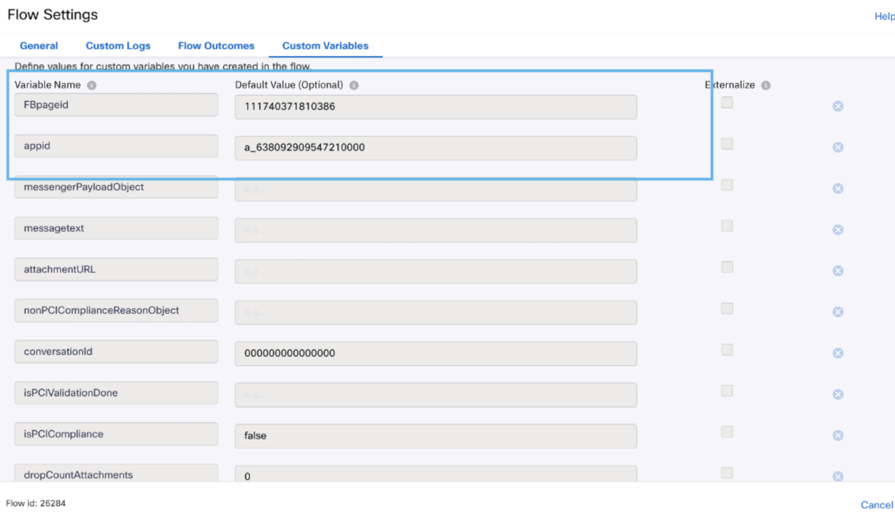

# Media Specific Workflows

## Workflows Overview

The following workflow template is included:

- **Facebook Inbound Flow** - This workflow will be triggered for every inbound customer message over the integrated Facebook page.

### Important Notes

- Queue selection in the Queue Task node is mandatory before making the flow live.
- Flow variables must be updated in the Settings section with the correct asset details before making the flow live.

## Updating Flow Variables

The following flow variable must be updated under the custom variables section:

- Facebook: `FBpageid` and `appid`

### Facebook Inbound Flow Details

The Facebook Messenger flow follows this sequence:

`Incoming Message` → `Evaluate` → `Resolve Conversation` → `Messenger (Message is resolved)` → `Queue Task` → `Queued`

The flow also includes policy-failure, timeout, task-failure, branch, close-task, and Messenger error paths that should be validated during deployment.

#### 1. Incoming Message

The Facebook Messenger Start node receives inbound customer messages and begins the flow. The overview connects the Start node to the Evaluate node through the `onBegin` transition.

#### 2. Evaluate

The Evaluate node prepares the Facebook message, customer details, attachment payload, and security information for Resolve Conversation.

The script:

- Extracts the transaction identifier and normalizes `transId` to the portion before the underscore.
- Converts a blank, null, or undefined customer message to `<del><no-text-sent></del>`.
- Serializes and escapes message content before placing it in the conversation details.
- Defaults an unknown or missing customer name to `User`.
- Parses the Messenger attachment payload from the custom variable `messengerPayloadObject`.
- Identifies PCI-dropped attachments and marks them with `dropped: true`.
- Adds accepted attachments with MIME type, filename, URL, and `dropped: false`.
- Extracts the actual filename from secure `download-media` URLs when required.
- Creates an empty attachment array when no attachment is available.
- Builds message, PCI, malware-scan, and security-scan details.
- Serializes the complete payload as `detailsJson`.

The required custom variable is:

- `messengerPayloadObject` = `messenger.attachments`

The generated message details include:

- `appId`
- `FBpageid`
- `psId`
- `customerName`
- `resolveConversationmessagetext`
- `resolveConversationMessengerPayloadObject`
- `attachmentURL`
- `serviceKey`
- `timestamp`

#### 3. Resolve Conversation

Creates or updates the Webex Contact Center conversation for Facebook Messenger.

- Method: `Resolve Conversation`
- Node authentication: `Your configured authorization profile`
- Trans ID: `$(transId)`
- Media type: `Social`
- Media channel: `Facebook Messenger`
- Details: `$(detailsJson)`
- Override Default Contact Close Event Handling: Not enabled
- Version: `v1.3`
- Node reference: `Use the relevant node in your tenant flow`

#### 4. Resolution Messenger Message

Sends a confirmation message to the Facebook customer after the conversation is resolved.

- Node type: `Messenger`
- Destination type: `PS Id`
- Destination: `$(n2.messenger.psId)`
- Messaging type: `RESPONSE`
- Notification type: `REGULAR`
- Message type: `Text`
- Message: `Message is resolved`
- Quick replies: Not configured
- Node reference: `Use the relevant Messenger node in your tenant flow`

#### 5. Queue Task

Submits the Facebook conversation to Webex Contact Center for agent assignment.

- Method: `Queue task`
- Node authentication: `Your configured authorization profile`
- Task ID: `$(taskId)`
- Conversation ID: `$(conversationId)`
- Media type: `Social`
- Media channel: `Facebook Messenger`
- Queue mode: `Static`
- Queue name: `Your configured queue name`
- Contact priority: `As configured for your environment`
- Queue routing type: `Longest available agent`
- Version: `v1.8`
- Node reference: `Use the relevant Queue Task node in your tenant flow`

#### 6. Queued Message

The flow overview shows a Queued Messenger node after Queue Task. It sends the success response after the task is queued. The opened configuration for this node was not supplied, so its destination and message values must be verified in the flow before deployment.

### Facebook Deployment Notes

- Update `FBpageid`, the Facebook Messenger asset, authentication profiles, Flow ID, and queue name for the target tenant.
- Use the correct authorization profile and queue settings for your environment.
- Confirm that `psId` is available from the Facebook Start node and is used for the Messenger destination.
- Confirm that `detailsJson` is generated successfully before Resolve Conversation executes.
- Test text messages, blank messages, accepted attachments, dropped PCI attachments, secure `download-media` URLs, malware/security failures, timeouts, and task failures.
- Verify the queued Messenger node and all branch, close-task, and error-notification paths before making the flow live.

## Enhancements Included

- Facebook
  - Support for inbound customer messages from the integrated Facebook page
  - Support for attachment handling, PCI validation, and security checks
  - Support for successful resolution, queueing, and queued notifications
- Bot flows
  - Updated to ensure flows get imported without any errors

## How to setup the workflow?

- Follow the process for organization setup in WxCC with IMI integration.
- Download the sample flow template from the repository.
- Import the flow in your Webex Connect service.
- Add authorizations at the integration level.
- Update the Flow ID for the Resolve Conversation node to match your target tenant environment.
- Modify the flow as needed for your use case.
- Make the flow live with the configured assets.

Additional product documentation is available in the Webex Connect platform documentation.

- Log in to your Webex Connect account.
- Click `Documentation` under the `Help` section.
- Under `Getting Started`, click `Webex Connect Platform Overview`.
- Scroll down to the `Webex Contact Center and Webex Connect Integration` section.
- Click `Overview`.
