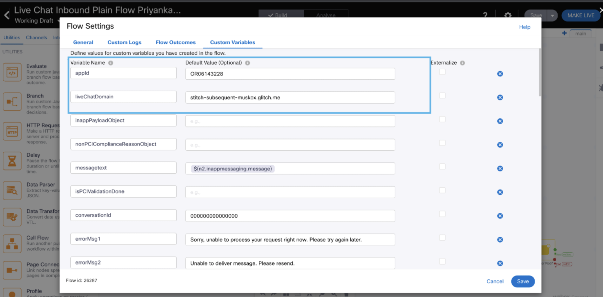
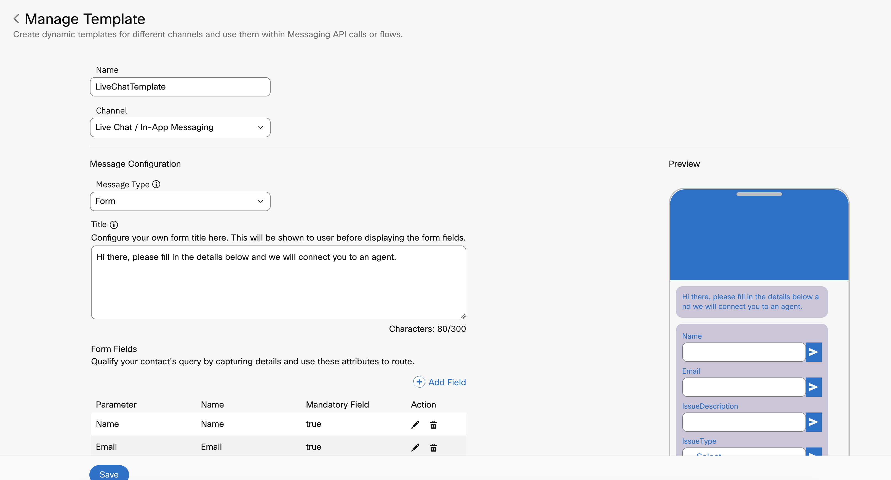
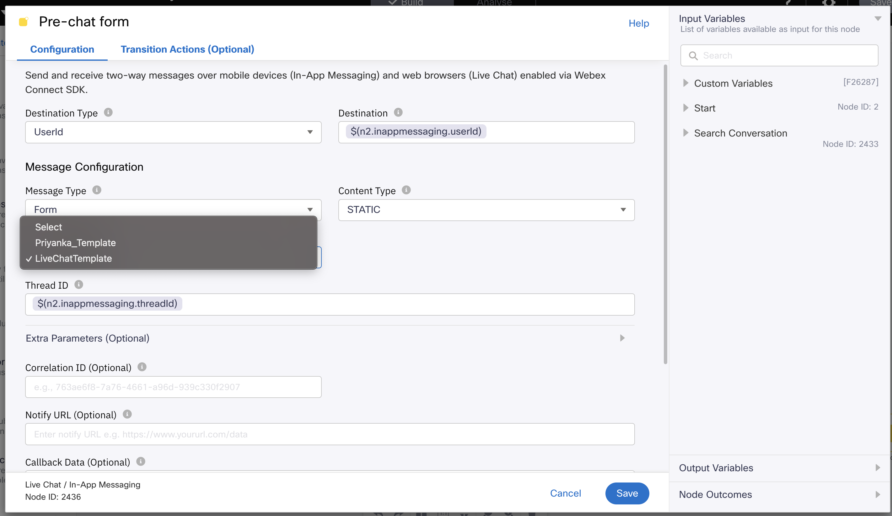
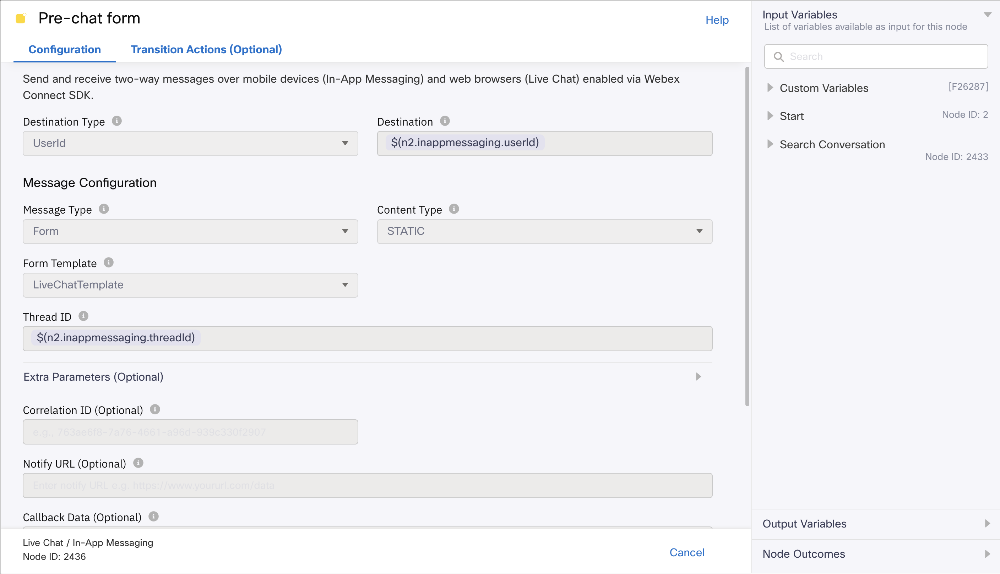
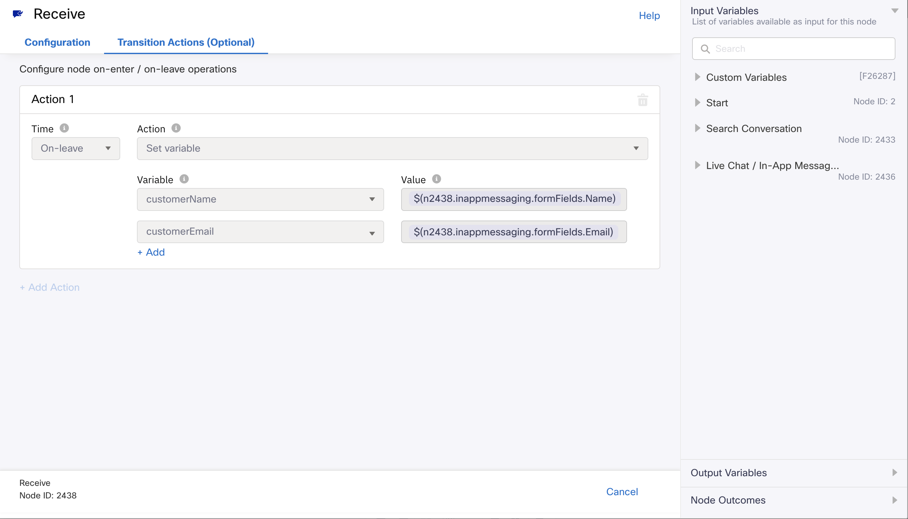
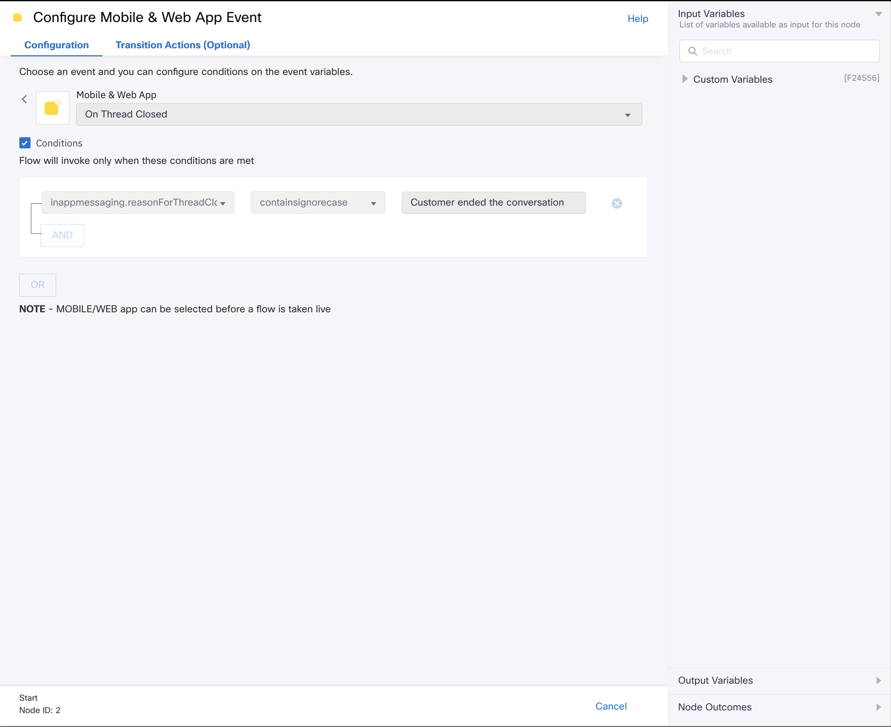
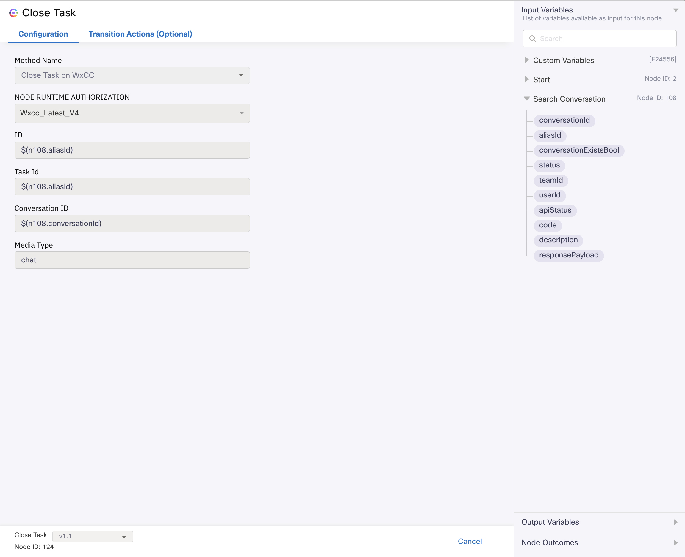

# Media Specific Workflows

## Workflows Overview

The following workflow template is included for the Mobile In-App Messaging channel:

**Media Specific Workflows**: These flows need to be imported once per asset of the specific channel.

- **In-App Messaging Inbound Flow** - This workflow is used for inbound customer conversations coming from the Mobile In-App messaging app on Android or iOS.
- **In-App Messaging Close Flow** - This workflow is triggered when the customer closes the in-app conversation.

The In-App Messaging flow uses the same pattern and logic as the current Live Chat flow, but the inbound chat request originates from the mobile application instead of the web chat widget.

Note :

- Queue selection from queue task node is mandatory for any channel flows before making the flow live.
- Flow variables must be updated in the setting section with the correct asset details before making the flow live.

## Updating Flow Variables

Flow variables that need to be updated under Custom Variables for the Mobile In-App Messaging flow:

- In-App Messaging: `appId` and the relevant mobile application or channel configuration values

  

### In-App Messaging Inbound Flow Details

- The Mobile In-App Messaging flow uses the same Live Chat flow design and logic.
- The inbound request originates from the mobile application (Android or iOS) instead of the web chat widget.
- The same pre-chat form, Receive node, Evaluate node, Resolve Conversation, Append Conversation, Queue Task, and queued message pattern is used.
  Sample template is shown in below image

    

- In the Mobile In-App Messaging node we have selected the message type as form and we have to choose the template from the dropdown which contains the list of available in-app templates for that tenant

    

- In this sample we have filled the template as LiveChatTemplate(the sample one shown in above image)

    

- In the Receive node transition action we need to set the variable customerName and customerEmail and this customerName and customerEmail will
  be visible on the agent desktop.

- We are getting the value for customerName and customerEmail from the in-app form.
- The value of customerName and customerEmail will be extracted from the in-app form response. In the sample in-app template, "Name" and "Email" fields are configured. Hence, `$(n2438.inappmessaging.formFields.Name)`
  and `$(n2438.inappmessaging.formFields.Email)` and configured as values for customerName and customerEmail variables respectively.
  Based on your form fields, the value for the above variables will change, however; the variable names i.e customerName and customerEmail must remain intact.
- For instance, if the form fields are named as UserName and UserEmail, the customerName and customerEmail variables must be set as `$(n2438.inappmessaging.formFields.UserName)` and
  `$(n2438.inappmessaging.formFields.UserEmail)` in the Receive node Transition Actions.

    

### In-App Messaging Close Flow Details

- This flow is invoked when the customer closes the Mobile In-App chat conversation from the application.
    
- AliasId is taken in from the Search Conversation response and passed on to the Close Task node as the task identifier, to terminate the task in the backend.
    

### Configured Mobile In-App Messaging Flow Reference

The Mobile In-App Messaging flow follows the same structure as the current Live Chat flow:

`Configure APP Event` → `Search Conversation` → `Pre-chat form` → `Receive` → `Evaluate` → `Resolve Conversation` → `Append Conversation` → `Queue Task` → `Queued`

The flow also contains Branch, Close Task, and Error Notification paths. The exact configuration of those supporting nodes should be verified separately before deployment.

#### 1. Configure APP Event

The Start node triggers the flow for an incoming application message.

- APP event: `Incoming message`
- Conditions: Enabled
- Condition: `inappmessaging.message notequals typing_indicator`
- Node ID: `2`

The condition prevents typing-indicator events from starting the customer-message flow. The required mobile or web application can be selected before the flow is made live.

#### 2. Search Conversation

Searches for the existing Mobile In-App Messaging conversation.

- Method: `Search Chat`
- Node authentication: `Your authentication profile`
- Channel: `In-App Messaging`
- Mobile app: `Your Mobile In-App app (Android or iOS)`
- App thread ID: `$(n2.inappmessaging.threadId)`
- App user ID: `$(n2.inappmessaging.userId)`
- App session identifier: `$(n2.inappmessaging.userId)`
- Version: `v2.2`

#### 3. Pre-chat Form

Sends the configured static pre-chat form to the customer.

- Destination type: `UserId`
- Destination: `$(n2.inappmessaging.userId)`
- Message type: `Form`
- Content type: `STATIC`
- Form template: `Your form template name`
- Thread ID: `$(n2.inappmessaging.threadId)`
- Optional correlation, notify URL, callback, and expiry fields: Not configured

#### 4. Receive

Waits for the customer to submit the pre-chat form.

- Maximum timeout: `300` seconds
- Channel event: `Receive Mobile In-App Messaging`
- From thread ID: `$(n2.inappmessaging.threadId)`
- From user ID: `$(n2.inappmessaging.userId)`
- Event name: `Form Response`
- Content type: `STATIC`
- Form template: `Your form template name`

The Receive node has an on-leave Set Variable action:

- `customerName` = `$(n<nodeId>.inappmessaging.formFields.Name)`
- `customerEmail` = `$(n<nodeId>.inappmessaging.formFields.Email)`

These variables are made available for downstream processing and can be displayed on the Agent Desktop. If the form field names change, update the expressions while keeping the standard flow variable names `customerName` and `customerEmail`.

#### 5. Evaluate

The Evaluate node prepares the message, attachment, and security information required by Resolve Conversation.

- Script output: `1`
- Branch name: `success`

The script:

- Extracts the flow portion from `transid`.
- Replaces a blank, undefined, or missing message with `No text`.
- Serializes and escapes newline, quote, slash, and control characters in the message.
- Parses the Live Chat attachment payload and PCI-compliance reason payload.
- Supports the custom variables `inappPayloadObject` and `nonPCIComplianceReasonObject`.
- Represents dropped attachments with their MIME type, filename `[Dropped]`, an empty URL, and `dropped: true`.
- Represents accepted attachments with the content type, filename extracted from the URL, URL, and `dropped: false`.
- Creates an empty JSON attachment array when no attachment is available.
- Defaults a blank `attachmentCount` to `0`.
- Uses `userId` as a fallback for blank `customerEmail` and `customerName`.
- Builds `messageDetails`, `pciDetails`, `malwareScanDetails`, and `securityScanDetails`.
- Serializes the combined object as `detailsJson`.

The required custom variables are:

- `inappPayloadObject` = `inappmessaging.attachment`
- `nonPCIComplianceReasonObject` = `inappmessaging.pciInfo.nonPCIComplianceReason`

#### 6. Resolve Conversation

Creates or updates the Webex Contact Center conversation using the prepared details.

- Method: `Resolve Conversation`
- Node authentication: `Wxcc Node Authorization`
- Trans ID: `$(transId)`
- Media type: `Chat`
- Media channel: `Live Chat / In-App Messaging`
- Details: `$(detailsJson)`
- Override Default Contact Close Event Handling: Enabled
- Version: `v1.3`

#### 7. Append Conversation

Appends the customer’s form response to the existing conversation.

- Method: `Append Chat`
- Node authentication: `Your authentication profile`
- Channel: `In-App Messaging`
- Conversation ID: `$(conversationId)`
- Message mode: `Single message`
- Message Alias ID: `$(n<searchNodeId>.aliasId)`
- Direction: `Inbound`
- Message type: `In-App form response`
- Form response: `$(n<receiveNodeId>.inappmessaging.formResponse)`
- Timestamp: `$(n<receiveNodeId>.inappmessaging.timestamp)`
- Version: `v2.2`

#### 8. Queue Task

Submits the conversation to Webex Contact Center for agent assignment.

- Method: `Queue task`
- Node authentication: `Wxcc Node Authorization`
- Task ID: `$(taskId)`
- Conversation ID: `$(conversationId)`
- Media type: `Chat`
- Media channel: `In-App Messaging`
- Queue mode: `Static`
- Queue name: `Your queue name`
- Contact priority: `Your configured priority`
- Queue routing type: `Longest available agent`
- Version: `v1.8`

#### 9. Queued Message

Sends a confirmation message after the task is successfully queued.

- Node type: `In-app messaging`
- Destination type: `UserId`
- Destination: `$(n2.inappmessaging.userId)`
- Message type: `Message`
- Message: `Message successfully queued`
- Thread ID: `$(n2.inappmessaging.threadId)`
- Notification title/text: Not configured

### In-App Messaging Deployment Notes

- Update the Mobile In-App Messaging application, authentication profiles, form template, Flow ID, and queue name for the target tenant.
- Keep `customerName` and `customerEmail` as the standard variables even when form field names change.
- Confirm that the Evaluate node produces `detailsJson` before Resolve Conversation executes.
- Verify PCI, malware, security-scan, and attachment scenarios, including dropped and accepted attachments.
- Test success, timeout, invalid-channel, and error-notification paths before making the flow live.
- The flow design remains the same as the current Live Chat flow; only the inbound source is the Mobile In-App application (Android or iOS).

## Enhancements Included

- In-App Messaging
  - Support for displaying customer name and email if available via form on the Agent Desktop
  - Same flow pattern as the existing Live Chat implementation for Mobile In-App conversations
- Bot flows
  - Updated to ensure flows get imported without any errors
